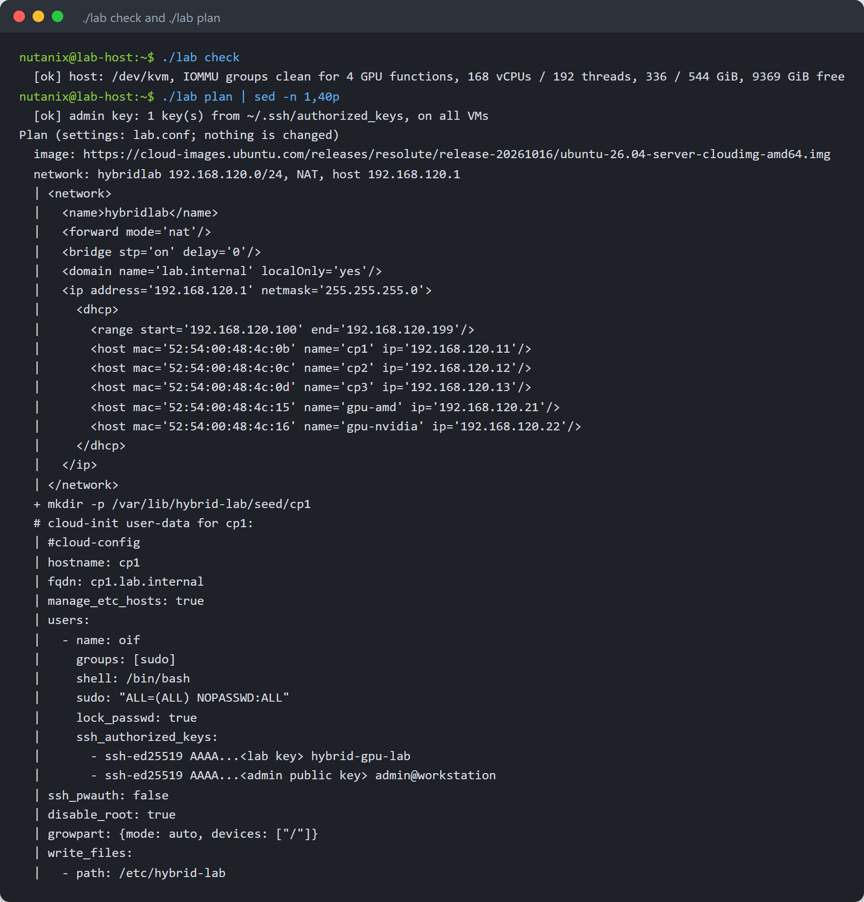
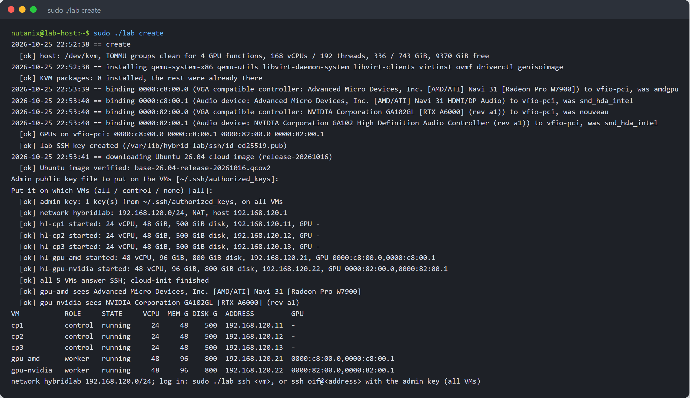
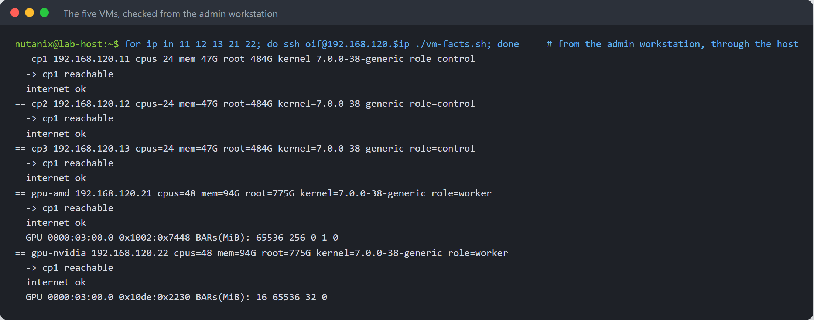
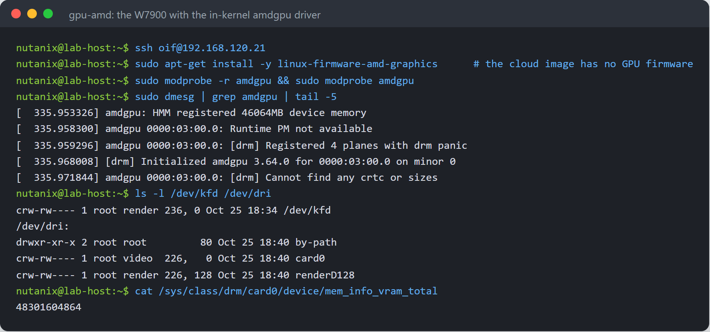
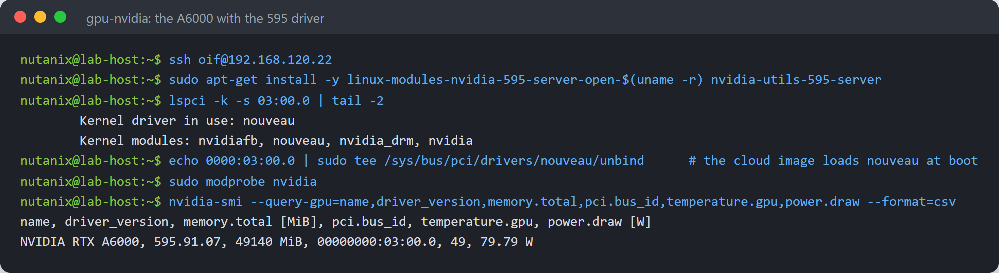
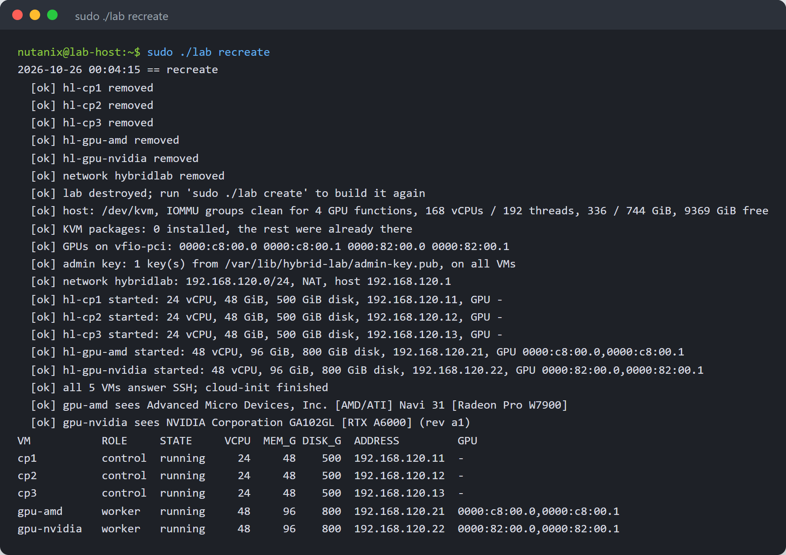
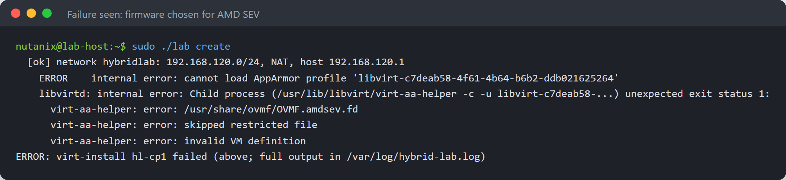

# Hybrid GPU Cluster Lab: installation guide

## What you get

In production, NVIDIA and AMD GPUs are not in the same server: a customer has NVIDIA servers and AMD servers, and joining them into one cluster has been hard. This guide builds that situation on one machine, so a hybrid cluster can be installed, tested, torn down and rebuilt as often as needed:

- **three control-plane VMs** for a highly available Kubernetes control plane;
- **one AMD GPU worker VM** that owns a Radeon PRO W7900 through PCI passthrough;
- **one NVIDIA GPU worker VM** that owns an RTX A6000 the same way;
- all five on **one private subnet with fixed addresses**, ready to form a cluster;
- the **admin's SSH key** on the VMs (all of them, the control plane only, or none: the admin chooses), and a lab key for the tooling.

One command line, `lab`, builds and removes it. It is a separate project from the cluster installer: it builds machines, not Kubernetes. The next guide installs a hybrid Run:ai cluster on these VMs with [oif](https://github.com/manmohanbrahma/open-inference-fabric).

Everything shown is from a real run on the reference host: Ubuntu 26.04.1, AMD EPYC 9684X, 751 GiB memory, an NVIDIA RTX A6000 and an AMD Radeon PRO W7900. Addresses on the lab's private subnet are shown as they are; the host's own address and name are placeholders.

The published version of this guide, with the architecture diagram: <https://manmohanbrahma.github.io/ai/hybrid-gpu-lab/>.

| Step | When |
| --- | --- |
| Host setup: KVM packages, GPU binding, an 860 MB image download | the first create only |
| Create the five VMs and wait until they answer SSH | every create, a few minutes |
| Destroy: VMs, disks and network | every destroy; the host setup and image stay |

## Sizing

| VM | Role | vCPU | Memory | Disk | NIC | GPU |
| --- | --- | --- | --- | --- | --- | --- |
| cp1, cp2, cp3 | control plane | 24 | 48 GiB | 500 GiB | 1 | none |
| gpu-amd | worker | 48 | 96 GiB | 800 GiB | 1 | AMD Radeon PRO W7900, 48 GB |
| gpu-nvidia | worker | 48 | 96 GiB | 800 GiB | 1 | NVIDIA RTX A6000, 48 GB |
| **Total** | | **168** | **336 GiB** | **3.1 TB** (thin) | | |

The disks are thin: a fresh VM uses a few GB. The reference host has 192 threads, 751 GiB and 9 TB free on its data disk; the root disk is too small for the VM disks, so they go on the data disk (`LAB_STORAGE`).

| Address | Name |
| --- | --- |
| 192.168.120.1 | the host (NAT gateway) |
| 192.168.120.11, .12, .13 | cp1, cp2, cp3 |
| 192.168.120.21 | gpu-amd |
| 192.168.120.22 | gpu-nvidia |
| 192.168.120.100 to .199 | free DHCP range; .10 and .240 to .250 are left for a cluster address and load balancers |

## Before you start

- Ubuntu 26.04 on the host, with AMD-V (or VT-x) and the IOMMU enabled in the BIOS
- Each GPU in an IOMMU group of its own, together only with its HDMI audio function
- The GPUs not driving a display and not in use by anything on the host (no Kubernetes or GPU drivers using them)
- Memory, CPUs and disk space for the VMs; outbound HTTPS to cloud-images.ubuntu.com and the Ubuntu archive
- An SSH public key for the admin on the host (by default the keys you log in with)

Find the GPUs' PCI addresses and their groups:

```bash
lspci -nn | grep -Ei 'vga|3d|audio'
for d in 0000:82:00.0 0000:82:00.1 0000:c8:00.0 0000:c8:00.1; do
  echo "$d group $(basename $(readlink /sys/bus/pci/devices/$d/iommu_group))"; done
```

## Get the lab and check the host

```bash
git clone https://github.com/manmohanbrahma/hybrid-gpu-lab.git
cd hybrid-gpu-lab
cp lab.conf.example lab.conf      # set LAB_STORAGE and the GPUs' PCI addresses
./lab check                       # read-only: KVM, IOMMU groups, CPUs, memory, disk
./lab plan                        # what create would do; changes nothing
```

`lab.conf` holds one line per VM: name, role, vCPUs, memory, disk, the last octet of its address, and the GPU's PCI functions (every function of the card: the GPU and its audio device, because passthrough moves whole IOMMU groups).



## Create the lab

```bash
sudo ./lab create
```

On first use it sets up the host, then builds the VMs:

1. Installs the KVM packages that are missing: QEMU, libvirt, virt-install, the OVMF firmware, driverctl and genisoimage. It records which ones it installed.
2. Binds each GPU function to `vfio-pci` with `driverctl`, so the host's drivers let go of the cards; the binding survives reboots.
3. Downloads the Ubuntu 26.04 cloud image of the pinned release and checks its SHA-256 checksum.
4. Asks for the admin's public key and where to put it: **all** VMs, **control**-plane VMs only, or **none**. The answer is remembered.
5. Creates the private NAT network, a thin disk per VM on top of the image, and each VM with cloud-init: host name, user `oif` with passwordless sudo, SSH keys only.
6. Waits until every VM answers SSH and cloud-init has finished, then checks that each GPU VM sees its card.



## Check the VMs

Log in with the admin key from the admin's workstation, through the host:

```bash
ssh -J <user>@<host-ip> oif@192.168.120.21
sudo ./lab ssh gpu-amd            # or from the host with the lab key
sudo ./lab status
```



## The GPUs inside the VMs

The lab installs no GPU drivers: the cluster installer does that per node. To check the cards by hand, load each vendor's driver in its VM.

The W7900 with the kernel's own `amdgpu` driver. The cloud image has no GPU firmware, so install it first:

```bash
sudo apt-get install -y linux-firmware-amd-graphics
sudo modprobe -r amdgpu && sudo modprobe amdgpu
```



The A6000 with the NVIDIA 595 server driver, the same version as on the bare-metal host. The cloud image loads `nouveau` at boot, so it has to let go of the card first:

```bash
sudo apt-get install -y linux-modules-nvidia-595-server-open-$(uname -r) nvidia-utils-595-server
echo 0000:03:00.0 | sudo tee /sys/bus/pci/drivers/nouveau/unbind
sudo modprobe nvidia && nvidia-smi
```



| VM | Needs on top of the cloud image | Then |
| --- | --- | --- |
| gpu-amd | `linux-firmware-amd-graphics` | `amdgpu` in the Ubuntu kernel initialises the GPU |
| gpu-nvidia | `nouveau` blocked; NVIDIA kernel modules and utilities | `nvidia-smi` shows the GPU |

## Destroy and create again

```bash
sudo ./lab destroy                # VMs, disks and network gone; host setup and image kept
sudo ./lab recreate               # destroy, then create
```



The GPUs stay on `vfio-pci` between runs, so a new VM gets its card straight away. A GPU whose driver was active when its VM was destroyed must reset before the next VM can use it; the W7900 is a workstation GPU, and this is the case worth testing on your hardware.

## SSH keys

| Key | Where | Used for |
| --- | --- | --- |
| Admin's public key | all VMs, control-plane VMs only, or none (`LAB_ADMIN_KEY_ON`) | the admin logs in as `oif` |
| Lab key, `/var/lib/hybrid-lab/ssh/id_ed25519` (root-only) | every VM | `./lab ssh` and the readiness checks |

The admin's choice is asked once and kept; set `LAB_ADMIN_KEY` and `LAB_ADMIN_KEY_ON` in `lab.conf` to skip the question. Password login is off on every VM. The cluster installer brings its own key for the cluster and asks again whether the admin's key stays on the control plane.

## What changes on the host

| Change | Removed by |
| --- | --- |
| KVM packages the lab installed (recorded) | `sudo ./lab host-clean` |
| GPU functions bound to `vfio-pci` (driverctl, kept across reboots) | `host-clean`; reboot for a clean driver start |
| libvirt network `hybridlab` and the VMs `hl-*`, their disks in `LAB_STORAGE` | `sudo ./lab destroy` |
| `/var/lib/hybrid-lab` (state, lab key, cloud-init seeds) and the base image | `host-clean` (the log `/var/log/hybrid-lab.log` stays) |

```bash
sudo ./lab host-clean             # destroy, then undo the host setup
```

## Troubleshooting



| Problem | Cause and fix |
| --- | --- |
| `cannot load AppArmor profile`, `virt-aa-helper: error: /usr/share/ovmf/OVMF.amdsev.fd ... skipped restricted file` | libvirt chose the AMD SEV firmware on an EPYC host. The lab names `OVMF_CODE_4M.fd` (`LAB_OVMF_CODE`, `LAB_OVMF_VARS`); secure boot stays off so the NVIDIA driver loads. |
| `<address> shares IOMMU group ... with ...` | Another device is in the GPU's group: list every function of the card in `lab.conf`, or move the card to another slot. |
| The host hangs while binding a GPU to vfio-pci | The host's driver could not let go of the card: reboot; the binding is saved and takes effect at boot. |
| `amdgpu ... Direct firmware load ... failed`, `Fatal error during GPU init` in gpu-amd | The cloud image has no GPU firmware: install `linux-firmware-amd-graphics`. |
| `NVRM: GPU ... is already bound to nouveau` in gpu-nvidia | Block `nouveau` (or unbind it) before loading `nvidia`. |
| A VM does not answer SSH after 10 minutes | `sudo virsh console hl-<name>` shows its boot; `sudo ./lab recreate` builds it again. |
